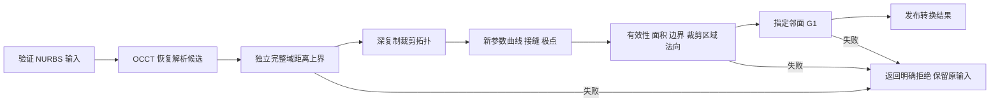

# BS2Quad 算法方案

## 1. 需求与实现边界

目标是识别可等效的 NURBS 支撑面，恢复解析表达，再验证裁剪面是否可替换。默认距离容差为 `1e-5 mm`，边界阈值独立固定为 `1e-5 mm`，有向法向夹角阈值为 `0.1°`。题面 `1.e5` 按更严格的 `1.e-5` 实现；最终口径以命题方为准。

覆盖平面、圆柱、圆锥、球面和环状圆环面。圆环面保留在原有 `QuadricType` 枚举中，但不将其称作数学上的一般二次曲面。

| 赛题要求 | 实现路径 | 验收依据 |
|---|---|---|
| 判定与转换 | 内核候选恢复，独立距离验收，深复制拓扑重建 | 正例/负例、位置变化、部分面、完整闭面、周期与非夹持样条 |
| 最大与平均距离 | 原始样条完整参数域的单向支撑面距离上界 | 区间/Bernstein 充分条件；诊断采样单独保存 |
| 边界 Hausdorff | 原边界对应的新参数曲线及双向边界并集距离 | 有限边界采样到完整目标边的距离，属于采样验收 |
| 相邻 G1 | 指定真实邻面和原共享边，在同一空间位置比较有向法向 | 33 个共享边样点；超过 0.1° 拒绝 |
| 10 ms 判定 | 候选恢复及完整域距离验收，独立记录计时边界 | 50–200 控制点的固定配方与逐例最大值；不含读写、生成、后续 CAD 操作及拓扑重建 |
| 三类 CAD 耗时降低 50% | 同一有限裁剪域和相同输入，检查输出后比较 | 预热、交替顺序、5/7 次原始耗时与中位数；未达标项单列 |
| C++ 与 SGK 1.7 | 当前 C++17/OCCT 7.7.0，SGK 无模拟适配 | SGK 1.7 目标构建和运行仍未完成 |
| 连续处理与异常 | 串行批处理、错误关闭、原输入保留、输出写入检查 | 1000 例重复运行、损坏文件/非法参数/写失败、ASan/UBSan/Valgrind 实际范围 |

完整域支撑面距离证书不会自动变成连续边界或 G1 证书。每个检查分别记录是否执行、是否完整、误差和结果，未执行量使用无穷值，JSON 输出为 `null`。

## 2. 处理流程

仅有支撑面输入时，执行到支撑面验收，不生成虚构边界或邻面结果。CLI 单面文件入口无法推断装配邻接，应由 C++ 调用方提供要求 G1 的邻面；锐边不是要求平滑的邻面。

## 3. 候选恢复

OCCT `GeomConvert_SurfToAnaSurf` 根据原曲面的几何结构恢复解析候选，支持按目标类型调用。该成熟能力被明确归属于依赖内核。内核 gap 和类型候选都不能绕过独立验收。

数据入口检查空对象、非有限控制点、非正/非有限权重、无效节点和参数域。内核异常保留失败类别，不能被转译为“该面已经被证明不是解析面”。

## 4. 完整参数域距离上界

将有理张量积样条写为齐次坐标 `S=(X/W,Y/W,Z/W)`。对原控制网做区间包围的精确插结，内部节点提高到次数重数，得到每个活跃跨度对应的有理 Bézier 控制网。周期基使用内核实际展开节点序列及循环控制点；非夹持端点使用真实节点位置，保留最后一个参与插值的控制点。

设解析面的齐次隐式残差分子为 `P(X,Y,Z,W)`，空间代数次数为 `m`。Bernstein 凸包性质给出 `|P| ≤ M`，其中 `M` 为全部系数区间端点绝对值的最大值。正权重满足 `W ≥ w_min > 0`，因此隐式残差绝对值不超过 `M / w_min^m`。

转换到几何距离的充分上界：

| 类型 | 残差 | 几何距离上界 |
|---|---|---|
| 平面 | 单位法向 `n·(p-c)` | 残差绝对值 |
| 球面 | `||p-c||²-r²` | `|F|/r` |
| 圆柱 | `rho²-r²` | `|F|/r` |
| 圆锥 | `cos²(a)*rho²-(r*cos(a)+z*sin(a))²` | `sqrt(|F|)`，含顶点仍保守 |
| 环状圆环 | `(rho²+z²+R²-r²)²-4R²*rho²` | `|F|/[r*(R²-r²)]`，要求 `R>r>0` |

实际计算在解析原点附近进行，法向/轴向系数也使用区间归一化。每一步算术向外舍入；圆锥三角系数由区间 Taylor 展开和余项包围。溢出、无效分母、超出次数预算或不能构造上界时拒绝发证。当前次数预算上限为 12。

完整域最大距离界不超过 `d` 时，任何归一化非负权重下的平均距离也不超过 `d`。输出的 `avgDistance` 仍仅是均匀参数采样诊断均值，未冒充面积加权实测均值。

## 5. 保持证明条件的性能优化

Bernstein 乘积权重只依赖次数，按次数缓存其区间包围和输出下标，不缓存输入几何或先前判定。平方中的非对角对称项具有同一精确系数，合并为带 `2` 倍权重的一项，减少重复区间运算。对角项只计算一次。该优化不减少采样、不缩小验证域、不放宽阈值。

缓存是线程局部的；同一转换器的统计状态仍要求单线程使用。实际冷启动、输入生成与操作范围由原始记录说明，不使用后续 CAD 计时填充判定耗时。

## 6. 裁剪与邻面

深复制输入拓扑后识别局部支撑几何，保留位置变换。解析参数框架对齐原接缝，法向在对应空间位置比较。给复制后的边建立新参数曲线，并检查周期边两个方向；极点退化边根据有序相邻参数曲线恢复其角区间，接缝修复后重新映射极点区间。

结果必须通过拓扑有效性、边/环数量、边和顶点容差、自适应面积比较、双向裁剪内部覆盖、双向边界并集距离及有向法向保持。修复后的拓扑面和返回的支撑面都采用输入对应的世界坐标。

指定邻面必须与输入面共享实际拓扑边，且不能是输入面自身。沿原共享边确认两面的支撑和边界对应后，以面方向确定的有向法向比较角度。反向的 180° 不能取绝对点积后变成 0°。

## 7. 稳定性、接口与测试

公开验收位置是 `Convert/ConvertBatch`、`ValidateAccuracy`、邻面检查、各 fitter 以及 CLI。有限点拟合独立使用归一化、条件数检查、代数初值与有界几何迭代；接受前对真正存储的世界坐标几何再次检查最大残差。有限点拟合不对点间曲面发证。

回归包含躲过采样列的窄凸起、非夹持高端点丢控制点、周期低重数、位置/参数化变化、完整球面极点、边界多孔、错误法向、重复点/共线点、超大世界坐标舍入、无效输入、空布尔结果和缓冲写失败。完整验收脚本同时检查保存回执、测试数量和性能标志，不把“执行结束”当作“指标通过”。

## 8. SGK 集成清单

取得真实 SGK 1.7 SDK 和许可后，依次完成初始化/释放、NURBS 数组与位置提取、解析几何构造、裁剪边与参数曲线更新、投影/求交/布尔、错误映射以及目标编译链接。先跑现有反例，再跑同一 1000 例与真实船舶面，最后重测三类操作。只有这些回执齐备后才将兼容性状态改为通过。
