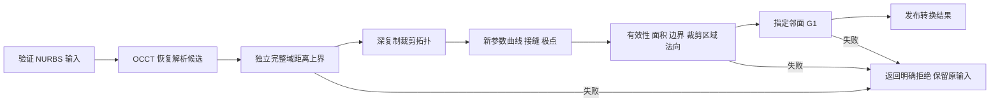
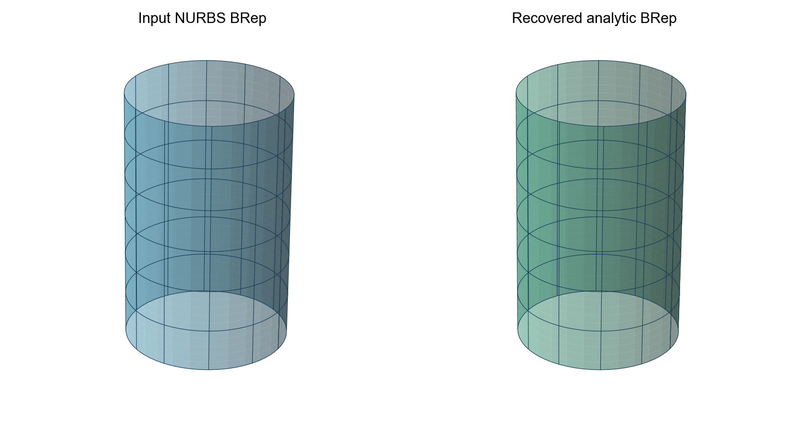
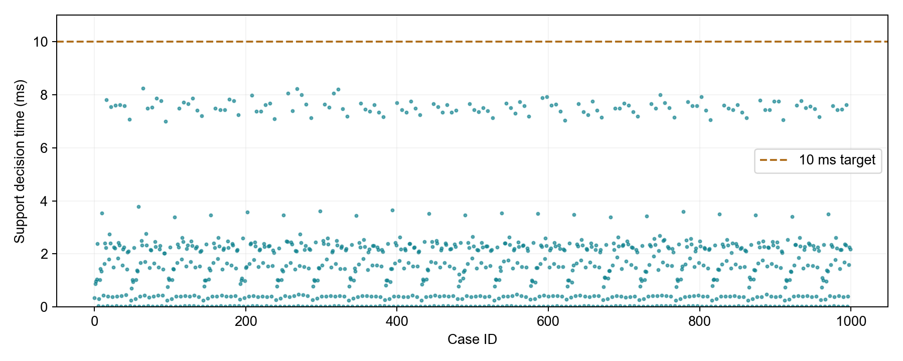

# BS2Quad 详细作品说明

## 一、任务、使用场景与交付状态

船舶设计人员在大型装配中反复进行投影、求交和布尔操作。输入虽然以 NURBS 保存，其中仍可能包含圆柱、球面等解析结构。本项目先恢复解析候选，再检查该输入是否满足替换条件，避免只凭拟合样点的小误差作接受决定。

本轮目标是提供可复现的 C++ 实现、测试与原始证据。在线路径是确定性几何计算；没有在运行时接入大模型。成熟候选恢复来自 OCCT，本项目工程增量是独立距离界、裁剪与方向验收、成本控制和可追溯结果。尚未完成系统文献查新，不宣称方法首创。

| 状态 | 实际情况 |
|---|---|
| 已实现 | 五类解析支撑面、单裁剪面、指定邻面、有限点拟合、文件与批处理入口 |
| 已运行 | Linux / GCC 11.4 / OCCT 7.7.0；64 单元测试及原始数据回执 |
| 已测量 | 1000 例合成支撑面，15 组同域 CAD 测量；未将其扩张为真实船舶全量验证 |
| 尚未通过 | SGK 1.7、全部 CAD 50%、完整 STEP 出口无泄漏、连续边界与 G1 证明 |
| 本次材料状态 | 生成作品说明、操作指南、真实 CLI 回放和中文旁白；不代表邮件或门户已提交 |

## 二、算法与工程设计

### 需求与实现边界

目标是识别可等效的 NURBS 支撑面，恢复解析表达，再验证裁剪面是否可替换。默认距离容差为 `1e-5 mm`，边界阈值独立固定为 `1e-5 mm`，有向法向夹角阈值为 `0.1°`。题面 `1.e5` 按更严格的 `1.e-5` 实现；最终口径以命题方为准。

覆盖平面、圆柱、圆锥、球面和环状圆环面。圆环面保留在原有 `QuadricType` 枚举中，但不将其称作数学上的一般二次曲面。

| 赛题要求 | 实现路径 | 验收依据 |
|---|---|---|
| 判定与转换 | 内核候选恢复，独立距离验收，深复制拓扑重建 | 正例/负例、位置变化、部分面、完整闭面、周期与非夹持样条 |
| 最大与平均距离 | 原始样条完整参数域的单向支撑面距离上界 | 区间/Bernstein 充分条件；诊断采样单独保存 |
| 边界 Hausdorff | 原边界对应的新参数曲线及双向边界并集距离 | 有限边界采样到完整目标边的距离，属于采样验收 |
| 相邻 G1 | 指定真实邻面和原共享边，在同一空间位置比较有向法向 | 33 个共享边样点；超过 0.1° 拒绝 |
| 10 ms 判定 | 候选恢复及完整域距离验收，独立记录计时边界 | 50–200 控制点的固定配方与逐例最大值；不含读写、生成、后续 CAD 操作及拓扑重建 |
| 三类 CAD 耗时降低 50% | 同一有限裁剪域和相同输入，检查输出后比较 | 预热、交替顺序、5/7 次原始耗时与中位数；未达标项单列 |
| C++ 与 SGK 1.7 | 当前 C++17/OCCT 7.7.0，SGK 无模拟适配 | SGK 1.7 目标构建和运行仍未完成 |
| 连续处理与异常 | 串行批处理、错误关闭、原输入保留、输出写入检查 | 1000 例重复运行、损坏文件/非法参数/写失败、ASan/UBSan/Valgrind 实际范围 |

完整域支撑面距离证书不会自动变成连续边界或 G1 证书。每个检查分别记录是否执行、是否完整、误差和结果，未执行量使用无穷值，JSON 输出为 `null`。

### 处理流程

仅有支撑面输入时，执行到支撑面验收，不生成虚构边界或邻面结果。CLI 单面文件入口无法推断装配邻接，应由 C++ 调用方提供要求 G1 的邻面；锐边不是要求平滑的邻面。

### 候选恢复

OCCT `GeomConvert_SurfToAnaSurf` 根据原曲面的几何结构恢复解析候选，支持按目标类型调用。该成熟能力被明确归属于依赖内核。内核 gap 和类型候选都不能绕过独立验收。

数据入口检查空对象、非有限控制点、非正/非有限权重、无效节点和参数域。内核异常保留失败类别，不能被转译为“该面已经被证明不是解析面”。

### 完整参数域距离上界

将有理张量积样条写为齐次坐标 `S=(X/W,Y/W,Z/W)`。对原控制网做区间包围的精确插结，内部节点提高到次数重数，得到每个活跃跨度对应的有理 Bézier 控制网。周期基使用内核实际展开节点序列及循环控制点；非夹持端点使用真实节点位置，保留最后一个参与插值的控制点。

设解析面的齐次隐式残差分子为 `P(X,Y,Z,W)`，空间代数次数为 `m`。Bernstein 凸包性质给出 `|P| ≤ M`，其中 `M` 为全部系数区间端点绝对值的最大值。正权重满足 `W ≥ w_min > 0`，因此隐式残差绝对值不超过 `M / w_min^m`。

转换到几何距离的充分上界：

| 类型 | 残差 | 几何距离上界 |
|---|---|---|
| 平面 | 单位法向 `n·(p-c)` | 残差绝对值 |
| 球面 | `||p-c||²-r²` | `|F|/r` |
| 圆柱 | `rho²-r²` | `|F|/r` |
| 圆锥 | `cos²(a)*rho²-(r*cos(a)+z*sin(a))²` | `sqrt(|F|)`，含顶点仍保守 |
| 环状圆环 | `(rho²+z²+R²-r²)²-4R²*rho²` | `|F|/[r*(R²-r²)]`，要求 `R>r>0` |

实际计算在解析原点附近进行，法向/轴向系数也使用区间归一化。每一步算术向外舍入；圆锥三角系数由区间 Taylor 展开和余项包围。溢出、无效分母、超出次数预算或不能构造上界时拒绝发证。当前次数预算上限为 12。

完整域最大距离界不超过 `d` 时，任何归一化非负权重下的平均距离也不超过 `d`。输出的 `avgDistance` 仍仅是均匀参数采样诊断均值，未冒充面积加权实测均值。

### 保持证明条件的性能优化

Bernstein 乘积权重只依赖次数，按次数缓存其区间包围和输出下标，不缓存输入几何或先前判定。平方中的非对角对称项具有同一精确系数，合并为带 `2` 倍权重的一项，减少重复区间运算。对角项只计算一次。该优化不减少采样、不缩小验证域、不放宽阈值。

缓存是线程局部的；同一转换器的统计状态仍要求单线程使用。实际冷启动、输入生成与操作范围由原始记录说明，不使用后续 CAD 计时填充判定耗时。

### 裁剪与邻面

深复制输入拓扑后识别局部支撑几何，保留位置变换。解析参数框架对齐原接缝，法向在对应空间位置比较。给复制后的边建立新参数曲线，并检查周期边两个方向；极点退化边根据有序相邻参数曲线恢复其角区间，接缝修复后重新映射极点区间。

结果必须通过拓扑有效性、边/环数量、边和顶点容差、自适应面积比较、双向裁剪内部覆盖、双向边界并集距离及有向法向保持。修复后的拓扑面和返回的支撑面都采用输入对应的世界坐标。

指定邻面必须与输入面共享实际拓扑边，且不能是输入面自身。沿原共享边确认两面的支撑和边界对应后，以面方向确定的有向法向比较角度。反向的 180° 不能取绝对点积后变成 0°。

### 稳定性、接口与测试

公开验收位置是 `Convert/ConvertBatch`、`ValidateAccuracy`、邻面检查、各 fitter 以及 CLI。有限点拟合独立使用归一化、条件数检查、代数初值与有界几何迭代；接受前对真正存储的世界坐标几何再次检查最大残差。有限点拟合不对点间曲面发证。

回归包含躲过采样列的窄凸起、非夹持高端点丢控制点、周期低重数、位置/参数化变化、完整球面极点、边界多孔、错误法向、重复点/共线点、超大世界坐标舍入、无效输入、空布尔结果和缓冲写失败。完整验收脚本同时检查保存回执、测试数量和性能标志，不把“执行结束”当作“指标通过”。

### SGK 集成清单

取得真实 SGK 1.7 SDK 和许可后，依次完成初始化/释放、NURBS 数组与位置提取、解析几何构造、裁剪边与参数曲线更新、投影/求交/布尔、错误映射以及目标编译链接。先跑现有反例，再跑同一 1000 例与真实船舶面，最后重测三类操作。只有这些回执齐备后才将兼容性状态改为通过。

## 三、验证设计、原始结果与误差分析

### 环境与测试可行性

所有编译、测试与性能测量都在远程专属目录执行，本地仅编辑代码、管理版本和生成材料。

| 项目 | 实测配置 |
|---|---|
| CPU | Intel Xeon Gold 5218R @ 2.10 GHz，2 插槽，80 逻辑 CPU |
| 系统 | Linux x86-64，Ubuntu 22.04.2 容器，宿主内核 5.4 |
| 编译器 / 构建 | GCC 11.4.0 / CMake 3.22.1，C++17，Release `-O3` |
| 浮点约束 | `-fno-fast-math -ffp-contract=off`；`OMP_NUM_THREADS=1` |
| 几何内核 | 官方 OCCT V7_7_0 源码构建，实际动态链接 7.7.0 |
| 测试 / 内存工具 | Google Test 1.11.0，GCC ASan/UBSan，Valgrind 3.18.1 |

完整环境与动态库路径保存在 [environment-final.txt](../evidence/20261016/environment-final.txt)。OCCT 源码包 SHA-256 为 `4cadb6d0a9e92dbb1a4eeb48d497b009d8138ffde64f2468d4a1c3f10a052722`；下载、构建和安装日志保留。独立 Dockerfile 提供复现配方，本次使用的是已构建依赖的专属容器，未额外声称从该 Dockerfile 重新完成了一次全量镜像构建。

正例由真实解析面转换为精确有理 NURBS，再保形插结增加控制点；不把曲面采样点直接当作控制点。测试使用已知类型、已知半径和独立隐式残差，避免只用恢复器自身输出作为真值。反例、失败操作、无法写入文件与内核异常都有明确拒绝路径。

### 正确性、公开接口与反例

最终 [unit-final.xml](../evidence/20261016/unit-final.xml) 记录 **64 项单元测试，0 失败、0 错误、0 跳过**。五个 CTest 组全部通过：UnitTests、CADSemanticContracts、CreateCLIFixtures、CLIContracts、OutputFailureContracts。后四组包括生成真实文件、11 项 CAD 语义检查、22 项命令行检查和 6 项参数/输出失败检查；组数与单元测试数不能相加冒充不同曲面数量。

| 接口 / 行为 | 本轮验证内容 |
|---|---|
| `Convert(surface)`、`ConvertBatch` | 五类真值、旋转平移、升阶、非法控制点、自由曲面、空项后继续、重复一致性 |
| `Convert(face)` | 部分球/锥/环、完整闭合柱/球/环、位置变换、有效裁剪拓扑、原输入不变 |
| `Convert(face, neighbors)` | 真实共享边的平滑正例、90° 折角反例、自身邻面拒绝 |
| `ValidateAccuracy` 两个重载 | 窄凸起、偏移、无有效求值、边界多孔、不同参数化和位置、法向反转、独立边界阈值 |
| 全域距离证书 | 五类隐式残差、原周期低重数接缝、非夹持高端点、同一对象中 NaN 控制点 |
| 邻面 / 参考边接口 | 必须有真实邻接或参考边位于双方边界；180° 有向法向不能变成 0° |
| 五个 fitter | NURBS 路径、部分点云、薄圆柱、锥顶、环半径、秩不足、NaN、最大残差离群点、关闭细化、世界坐标舍入 |
| 分析器 / 异常处理 / 生成器 | 五类分析、空面、自由面、非法配置、精确控制网、错误分类和报告 |
| 性能及文件入口 | 空/失败 CAD 结果不能发布成功收益；BRep/STEP 读写、损坏文件、参数冲突、路径别名、缓冲写失败 |

该表是测试行为清单，未声称行覆盖率或分支覆盖率达到 100%。本轮未统计“注释率超过 50%”，不能将其记为已满足评分项。

修复保留了可重放回归：非夹持末端证书曾给出 0，但真实端点高度为 `0.01/6 mm`；窄凸起可躲过全部诊断采样列；原面翻转和邻面翻转曾被错误接受；空布尔结果曾生成看似成功的短耗时；缓冲写入失败曾返回成功。相应失败与修复后记录均保留在证据目录，不删除历史负结果。

### 1000 例连续处理与判定性能

主数据由 case id 确定尺寸、姿态及控制网，种子字段固定为 42。包含平面、圆柱、圆锥、球各 167 例，环状圆环 166 例，自由曲面 166 例，共 1000 例。实际控制点数最小 50、最大 200，覆盖 50、100、196、200 及其他长宽比。每例执行两次转换核对结果一致性；计时统计记录第一次。

| 指标 | 最终实测 |
|---|---:|
| 正例正确接受 / 反例正确拒绝 | 834 / 166 |
| 错误接受 / 错误拒绝 | 0 / 0 |
| 重复结果不一致 / 控制点越界 | 0 / 0 |
| 最大已接受单向完整域距离上界 | 1.7947498624541329e-6 mm |
| 判定平均 / P50 | 2.040974 / 1.533743 ms |
| 判定 P95 / P99 | 7.594653 / 7.879403 ms |
| 判定最大 | 8.247364 ms |
| 本轮 10 ms 门槛 | 通过 |

逐例 [cases.csv](../evidence/20261016/final-release-v3/surface1000/cases.csv)、[输入参数](../evidence/20261016/final-release-v3/surface1000/inputs.csv)、1000 个 BRep 输入及 [汇总](../evidence/20261016/final-release-v3/surface1000/summary.json) 一并提供。判定计时包括候选恢复、诊断采样和独立完整域距离验收；不包括数据生成、文件读写、裁剪拓扑重建、邻面检查或后续 CAD 操作。数据包括首次冷调用，未把预热后最好值当作每例结果。

这些是合成支撑面的观测结果，不是 1000 个真实船舶裁剪面、任意次数/权重组合或 SGK 的性能保证。证书是源参数域到解析支撑面的单向界；该最大界也约束任意归一化非负权重下的平均距离，但不等于反向裁剪覆盖证明。

### 同域 CAD 投影、求交与布尔测量

每类使用一张 100 控制点部分裁剪面，前后使用相同有限域、查询和操作数。每组一次预热、五次正式测量，交替前后执行顺序，中位数不含预热。结果核验和保存放在计时区间外。共 15 组、90 条逐次记录（15 条预热、75 条正式记录），没有用空交集或失败操作的耗时计算收益。

投影使用 25 个已知法向偏移点，完整边界距离与支撑面投影经周期 UV 映射和裁剪分类共同给出有限面距离，并与已知偏移真值核对。Section 使用穿过已知内点的同一有限平面；Common 使用同一裁剪盒。检查非空、拓扑有效、几何双向采样一致；布尔附加自适应面积比较。输出几何检查为有限采样，不是全局结果证书。

| 类型 | 投影前 / 后 ms | 降低 | 求交前 / 后 ms | 降低 | 布尔前 / 后 ms | 降低 |
|---|---:|---:|---:|---:|---:|---:|
| 平面 | 12.863 / 8.585 | 33.26% | 17.004 / 2.167 | 87.25% | 7.084 / 4.151 | 41.40% |
| 圆柱 | 14.556 / 6.737 | 53.71% | 18.944 / 3.041 | 83.95% | 8.821 / 4.290 | 51.37% |
| 球面 | 14.816 / 8.889 | 40.01% | 22.172 / 3.215 | 85.50% | 12.808 / 5.595 | 56.32% |
| 圆锥 | 15.050 / 7.983 | 46.96% | 21.394 / 3.150 | 85.27% | 10.399 / 5.074 | 51.21% |
| 圆环 | 15.230 / 9.129 | 40.06% | 22.768 / 3.219 | 85.86% | 12.574 / 11.432 | 9.08% |

全部 15 组结果检查有效，**9 组达到 50%**。求交 5/5、投影 1/5、布尔 3/5。平面/球/锥/环投影以及平面/环布尔未达标，完整目标状态为失败。圆柱和圆锥布尔接近门槛，重复运行有调度与频率波动，不能据此作跨机器保证。保存了 [原始逐次记录](../evidence/20261016/final-release-v3/cad/raw.csv)、[汇总](../evidence/20261016/final-release-v3/cad/summary.json)、输入/操作数/结果 BRep 和查询 CSV。

### 内存、异常和失败边界

| 检查 | 结果 | 证据与限制 |
|---|---|---|
| Release 五组 CTest | 全通过 | `final-release-v3/correctness.log` |
| ASan/UBSan 1000 例支撑转换 | exit 0 | `asan1000.log`，834 正例/166 反例；内核本身是普通 Release 构建 |
| ASan/UBSan 五组 CTest | 4/5 通过，exit 8 | CLI 有效 STEP 导出触发进程退出泄漏：2964 bytes / 138 allocations；原失败保留 |
| Valgrind 1000 例转换 | exit 0，0 errors | definite/indirect/possible lost 均为 0；still reachable 16 bytes，0 suppressed |
| Valgrind 46 项核心/点拟合/验证回归 | exit 0，46 通过，0 errors | 同上：lost 0、still reachable 16 bytes，未覆盖全部 STEP 出口路径 |
| 纯 OCCT STEP 退出泄漏对照 | 依赖问题复现，未解决 | 不初始化 STEP 时通过；只初始化为 2916 bytes / 136 allocations；导出 1、10、100 次均为 2964 bytes / 138 allocations，无增长观测 |

STEP 对照不链接 BS2Quad 代码，使用同一 OCCT 7.7.0。尝试公开会话清理与内存 Purge 后报告未消失，未添加 LSAN 抑制、未禁用泄漏检测、未采用绕过析构的退出方式。这一证据定位了当前依赖出口路径的问题，不能据“固定总量”宣称全程序无泄漏。对照源码、命令和原始日志见 [occt-step-control](../evidence/20261016/occt-step-control/)。

非法参数、损坏/缺失文件、输入输出别名及写失败可追溯到检查名、退出码和错误消息。正式验证脚本本轮最终返回 **1**：[status.tsv](../evidence/20261016/final-release-v3/status.tsv) 中 `compatibility_target=1`、`cad_target=1`，其余步骤为 0。该非零退出是保留未满足硬指标的结果，不能改写成全部通过。

### 误差分析、不足与下一步

区间 Bernstein 残差界独立于候选内核的 gap，减少采样漏检；其充分条件可能保守拒绝接近圆锥的可转换面。次数上限 12，环面限 `R>r>0`。边界/G1 仍需连续域界，装配事务替换与真实船舶模型尚未验证。部分点云可能病态，算法安全拒绝不代表几何上不存在解。

优先级依次为：真实 SGK 1.7 SDK 与目标环境适配、同一反例/1000 例复验；STEP 依赖生命周期问题的上游确认或经实测修复；真实裁剪面与邻接数据回放；为边界与法向建立连续误差界；对投影和圆环布尔的拓扑/边界耗时进行 profiling。完整算法与误差来源见 [方案](design.md) 和 [误差分析](error_analysis.md)。

本轮不提供虚构对比方案、推测的 SGK 性能或未测的注释达标率。历史原始失败、早期超过 10 ms 的记录和不同版本的 CAD 测量一起保留，最终结论只引用明确标识的 `final-release-v3`。

## 四、真实演示与证据来源

视频展示的是本次远程真实命令的事件回放，原始时间戳、命令、退出码和 stdout/stderr 合并 PTY 流保存为 asciicast v2。终端画面由原始事件重新排版绘制；命令输出顺序与关键字段未改写。执行完成后停留画面讲解，不将展示时长称为计算耗时。几何预览来自实际 BRep 支撑面求值，仅用于可视化。

一千例主统计以归档结果读取展示；录制没有重新跑该性能集合。新录制的圆柱面操作包含实际拓扑重建，其 conversion_ms 不与原主统计的 decision_ms 混用。自由曲面明确拒绝，退出码 1 是预期业务结果；四项针对性回归均返回成功测试结果。

### 原始依据索引

| 编号 | 依据 | 支持的主张及限制 |
|---|---|---|
| E1 | evidence/20261016/source-final.json、source-readback.json | 51 个源文件与验证配方同源；不包含生成文档 |
| E2 | evidence/20261016/unit-final.xml、final-release-v3/correctness.log | 64 单元测试、5 CTest 组通过；不代表全赛题通过 |
| E3 | final-release-v3/surface1000/cases.csv、inputs.csv、summary.json | 合成数据分类、实际控制点与判定时延，1000 BRep 输入保留 |
| E4 | final-release-v3/cad/raw.csv、summary.json、输入及结果 BRep | 15 组测量有效，9 达标；有限采样结果检查 |
| E5 | asan-ctest.log、asan1000.log、valgrind1000.log | 已运行范围与失败；STEP LSAN 未解决 |
| E6 | evidence/20261016/occt-step-control/ | 不含 BS2Quad 的 STEP 泄漏复现，固定有限对照 |
| E7 | submission-studio/evidence/real-demo/ | 新录制命令、时间、退出码、实际输出与二进制哈希 |
| E8 | submission-studio/assets/*.provenance.json、*.py 生成入口 | AI 示意与数据图来源分离；不能把示意图当实验截图 |

## 五、集成工作与提交前缺口

最高优先级是取得真实 SGK 1.7 SDK 并完成目标环境适配，然后用相同反例、原始输入与真实船舶裁剪面复验。未经实际初始化、编译链接和运算回执，不修改兼容性标志。当前 C++ 原型的可复现性不替代赛题指定内核要求。

其后分别优化未达到 50% 的投影和布尔工作负载，保留相同查询、操作数与有效输出条件。次数缓存的最终版本严格单因素消融尚未执行；早期跨版本优化记录只作为研发观测。边界和法向的连续证书、装配级事务替换与真实工业数据回放仍需独立完成。

官方活动页 https://www.oschina.net/os2026/ 的搜索索引与用户提供文本均给出 10 月 16 日 24:00 及 oscc@oschina.cn；本次页面直读未取得完整正文，规则具体版本以组委会通知为准。材料采用 Asia/Shanghai 时区。本次没有发送邮件、配置外部评委访问、上传门户或取得提交回执。

### 复现入口

安装见 INSTALL.md，完整验收使用 scripts/verify.sh。脚本拒绝覆盖非空证据目录，任何硬指标失败都会保留非零状态。当前完整验收返回 1，原因是 SGK 兼容门槛与 CAD 50% 门槛未通过。操作指南与视频使用相同场景编号，旁白、事件流及包清单另附。
